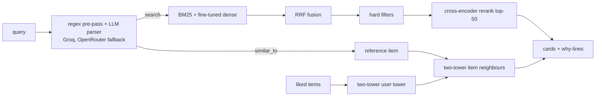

# CartRank

Product search and recommendation over ~52K Amazon Office Products items: hybrid BM25 + fine-tuned
dense retrieval, cross-encoder reranking, a two-tower recommender, and a small LLM layer that turns
free text ("black gel pens without clips under $10") into typed filters.

**Live demo:** https://cartrank.streamlit.app (free tier: it sleeps after about 12 hours idle, so click
to wake it; the first load downloads the models). Parsing uses Groq's free tier, which has a daily
token cap; when it is used up the app falls back to OpenRouter free models and then to regex-only
parsing, and says so on screen.

> Demo GIF: *pending* (to be recorded from the live app).

## What it does

- **Search:** parse the query, retrieve with BM25 and a fine-tuned bge-small encoder, fuse with
  reciprocal rank fusion, apply hard filters (price, rating, brand, must-have / exclude terms),
  rerank the top 50 with a cross-encoder. Every result carries a "why this" line built from catalog
  fields (matched terms, price, rating), never from LLM-written product claims.
- **Similar items:** "something like the Swingline 747" finds the reference item, then returns its
  nearest neighbours in the two-tower item space.
- **Recommend:** pick a few items you like in the sidebar; the user tower turns them into a vector.
- **Debug panel:** the parsed intent, candidates per stage, per-stage latency and process memory.

## Architecture



Offline: ESCI trains and evaluates search (encoder fine-tuned on Kaggle); Amazon Reviews 2023
(Office_Products, 5-core, temporal leave-last-out) trains and evaluates the recommender (popularity,
ItemKNN, BPR, two-tower; the two-tower was trained on Kaggle). Runtime files live in a private
Hugging Face repo and are downloaded at start-up.

## Results

Rule used throughout: no number appears without a results file the code wrote; the test splits are
run once, last. **Test-split results are pending** (the runner `eval/run_phase7.py` is written and
tested but not yet run). Dev numbers are shown for transparency and are optimistic because
configurations were tuned on them.

### Search, ESCI (Amazon's human-labelled shopping queries)

NDCG@10 with graded gains (Exact 1.0, Substitute 0.1, Complement 0.01). "Rerank mode" ranks each
query's judged products; "full-corpus" retrieves from all 482,105 products and counts unjudged
products as non-relevant, so it underestimates and is not comparable to rerank mode.

| System | Test, full-corpus | Test, rerank mode | Dev, full-corpus | Dev, rerank mode |
|---|---|---|---|---|
| BM25 | pending | pending | 0.3172 | 0.7011 |
| Dense, bge-small off-the-shelf | pending | pending | 0.3361 | 0.7261 |
| Dense, fine-tuned on ESCI | pending | pending | 0.3542 | 0.7351 |
| Hybrid (BM25 + fine-tuned dense) | pending | pending | 0.3776 | 0.7283 |
| Hybrid + cross-encoder (top-50) | pending | pending | 0.4070 | 0.7352 |

Dev = 2,089 queries. Fine-tuning improved the retriever (dense 0.3361 to 0.3542 on dev) but barely
improved the final pipeline once the cross-encoder was added (0.4052 to 0.4070 with the
off-the-shelf encoder vs the fine-tuned one); the cross-encoder does most of the work.

### Recommendation, Amazon Reviews 2023 Office_Products

Full ranking over all 77,551 items (no sampled negatives), temporal leave-last-out.

| Model | Test HR@10 | Test NDCG@10 | Dev HR@10 | Dev NDCG@10 | Dev cold-slice HR@10 |
|---|---|---|---|---|---|
| Popularity | pending | pending | 0.0111 | 0.0062 | 0.0000 |
| ItemKNN | pending | pending | 0.0269 | 0.0178 | 0.0109 |
| BPR-MF | pending | pending | 0.0260 | 0.0147 | 0.0002 |
| Two-tower, ID-only | pending | pending | 0.0392 | 0.0228 | 0.0003 |
| Two-tower, ID + text | pending | pending | 0.0462 | 0.0267 | 0.0005 |

The cold slice is the 10% of dev users whose target item has fewer than 5 train interactions. The
text embedding helped overall ranking but did not rescue cold items: ItemKNN is far better there.

### Query understanding (held-out set of 50 unseen queries, run once per frozen prompt)

| Parser | Constraint-intent exact match |
|---|---|
| Regex only | 0.42 |
| LLM, prompt v1 | 0.72 |
| LLM, prompt v2 | 0.92 |

End to end, on 21 queries that state at least two constraints, the share of top-10 results that
satisfy every constraint rose from 27.6% (plain search) to 92.4% (parser + hard filters); only 6 of
the 21 are held-out queries (13.3% to 75.0%), and the keyword-based constraints are judged by rules
the filter also uses, so read it as a mechanism check. Details: `results/query_layer.md`.

### Serving: memory

The app must fit a free tier, so memory is the tracked resource (budget 2.0 GB; Streamlit's docs list
about 2.7 GB as the ceiling). Latency is deliberately not reported: the demo runs on free tiers
(Streamlit Community Cloud, Groq and OpenRouter free plans), so timings there say little about the
system.

| Where | Resident memory | Source |
|---|---|---|
| Laptop, after loading everything and running 50 queries | 1,334 MB | `results/serving_footprint.md` |
| **Streamlit Community Cloud**, after 50 queries | 1,421 MB | `results/deployed_memory.md` |

The cross-encoder batch size mattered: at batch 64 the pipeline's memory grew to 2,406 MB over 50
queries; at batch 4 it stays at 1,421 MB with identical rankings (`results/ce_batch_memory.md`).

## Datasets and licences

- **Amazon Shopping Queries (ESCI):** repository under Apache-2.0; cite Reddy et al., 2022.
- **Amazon Reviews 2023:** the dataset card states no licence, so it is used for research only and
  the derived runtime files are in a private repo. Cite Hou et al., 2024.
- Models: bge-small-en-v1.5 (MIT), ms-marco-MiniLM-L6-v2 cross-encoder (Apache-2.0).

See `THIRD_PARTY_NOTICES.md`.

## Design decisions

- Ranking is the centrepiece; the LLM only parses and routes (no agent loop), which also keeps
  latency and free-tier token use low.
- Two datasets with two roles: ESCI has real human relevance labels but no prices; Reviews 2023 has
  prices and interactions but no query labels.
- Full-ranking recommender metrics instead of sampled negatives, which are known to mislead.
- Hard filters from the parser, because dense retrieval ignores negation and numeric constraints.
- A baseline row and a delta in every results table.

## What failed

Kept honest in `docs/what_failed.md`. Highlights: fine-tuning the encoder barely moved the final
pipeline; the two-tower text signal did not help cold items; BPR needed longer training and still
lost to ItemKNN; `.gitignore` swallowed the `cartrank.data` package so CI and the first deploy broke;
a cross-encoder batch size of 64 pushed memory past the budget; Groq's daily token cap was exhausted
by evaluation runs, which left the live demo without LLM parsing for hours.

## Limitations

- Full-corpus ESCI numbers underestimate quality (unjudged products count as non-relevant).
- The demo catalog has no relevance labels; the only check is a 50-query, owner-labelled P@10 sanity
  test (BM25 0.594 vs final 0.646).
- Reviews are a proxy for purchases; USD prices may be stale.
- The two query sets for the parser were written by the assistant and not yet reviewed by the owner.
- The free-tier app sleeps, and its LLM parsing is capped by Groq's daily token limit (about 270
  parses per day at the measured prompt size).
- "Similar to" results come from co-interaction, so accessories (for example staples for a stapler)
  can appear.

## How to run

```bash
make setup      # uv sync
make test       # pytest (the app tests need local model files and skip in CI)
make lint
make demo       # Streamlit app; needs the runtime artifacts (see below)
make quickstart # setup + lint + test, then the demo if HF_TOKEN is set
```

The runtime artifacts are in a private Hugging Face repo, so running the app locally needs an
`HF_TOKEN` with read access to it (put it in `.env`); the live demo needs nothing. Reproducing the
models from raw data needs the ESCI and Reviews 2023 downloads (`make data`), a Kaggle GPU for the
encoder fine-tune and the two-tower (`notebooks/kaggle/`), and API keys in `.env.example` for the
query parser.

## Layout

`src/cartrank/` data, search, recsys, query, serve, eval; `app/` Streamlit app; `notebooks/kaggle/`
GPU training; `evals/queries/` demo, gold and held-out query sets; `results/` every number quoted
here; `docs/` decisions, failures, interview notes.
